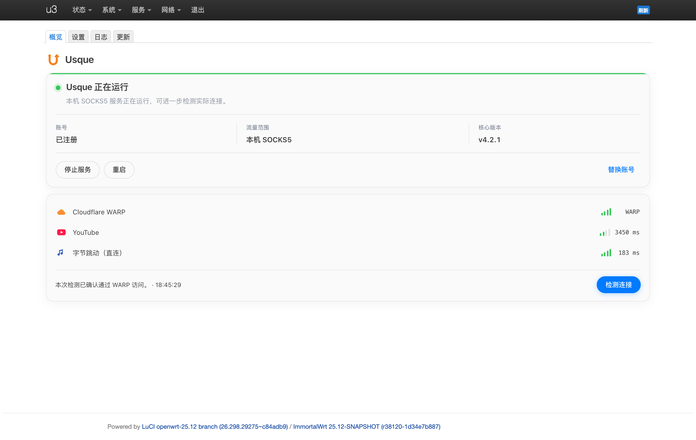
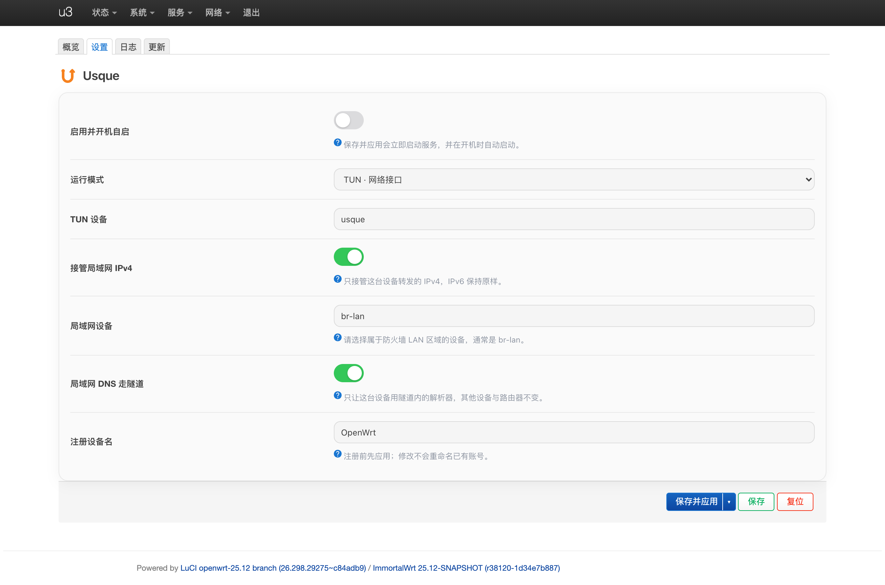
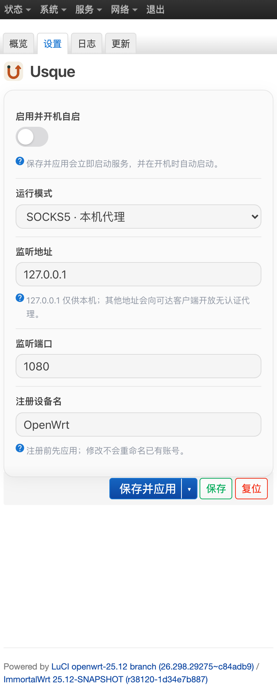

<p align="center"></p>
<h1 align="center">Usque for OpenWrt</h1>
<p align="center">看清 WARP 连接，掌握流量去向。</p>
<p align="center">
<a href="https://github.com/kenzok8/openwrt-usque/releases"></a>
<a href="https://github.com/kenzok8/openwrt-usque/releases"></a>
<a href="https://github.com/kenzok8/openwrt-usque/commits/main"></a>
<a href="https://github.com/kenzok8/openwrt-usque/stargazers"></a>
<a href="https://github.com/kenzok8/openwrt-usque/issues?q=is%3Aissue+is%3Aclosed"></a>
<a href="LICENSE"></a>
<a href="actions/workflows/build.yml"></a>
</p>

[Usque](https://github.com/Diniboy1123/usque) 通过 MASQUE 连接 Cloudflare WARP。本项目提供 OpenWrt 软件包、原生 LuCI 控制台、账号管理和 TUN 路由管理，上游核心保持 `v4.2.1`，不修改核心代码。

## 这是什么

把路由器接到 Cloudflare WARP 上的插件。链路是：设备 → 路由器上的 Usque → 加密隧道 → Cloudflare 节点 → 目标网站。对网站来说，你的来源变成了 Cloudflare 那边的出口 IP。

不需要机场、不需要订阅、不需要 Cloudflare 账号，也不需要手写任何配置文件。

| 能做 | 不能做 |
| --- | --- |
| 换出口 IP，普通网页访问走 Cloudflare 线路 | 没有订阅、节点列表，不能选国家 |
| 给这一段链路加密 | 不做分流，不能按网站决定走或直连 |
| 本机 SOCKS5，或让指定 LAN 设备的 IPv4 走隧道 | 不解锁地区内容，流媒体照样识别 |
| 界面里点几下就能用 | 不是全设备、全协议 VPN：IPv6 不管，本机普通请求不自动接管 |

要按网站分流、要选节点、要跑机场订阅，用 Clash / mihomo 那一类。Usque 只负责一根固定的出口管子：够用、省心，但不替代代理全套功能。

### 三步用起来

1. 服务 → Usque，点 **注册账号**，勾选同意条款。凭据自动申请，不用去 Cloudflare 注册。
2. 选模式：SOCKS5 用默认 `127.0.0.1:1080`；想整台设备走就选 TUN 并指定 LAN 设备（默认已填）。
3. 勾 **启用并开机自启** → 保存并应用 → 点 **检测连接**，看到 `warp=on` 才算真通。

### 关于注册

点击注册时，插件会调用 Cloudflare 的免费设备注册接口，拿回一组设备凭据（设备 ID、私钥、令牌、端点），存到 `/etc/usque/config.json`。它不是你 Cloudflare 账号下的一台机器，所以在 Cloudflare 仪表盘里看不到，也删不掉；想换身份就是重新注册，新凭据覆盖旧的。这一档是免费 WARP，不是 WARP+。

同一宽带短时间反复注册会被限速，表现为注册失败。插件失败时会保留旧账号，等一会儿再试，别连点。

### 两个容易踩的坑

- **检测通过只代表那一次请求通了**，不代表长期稳定。这条线路快慢会波动，卡顿时先重测，别急着改配置。
- **TUN 接管后打不开网站**，去设置里勾上`局域网 DNS 走隧道`。常见情况是流量进了隧道，域名却被解析成一个假地址，页面一直转圈。

## 接入点

默认用账户里记录的 Cloudflare WARP 入口。入口 IP 被线路封掉时（常见现象是检测全红、但其他网站正常），在设置页把 `接入点地址` 换成同段的其他入口即可，账户文件不会被改动。

实测：`162.159.198.2` 被封时，`162.159.198.1` 可以正常建隧道。

## 当前状态与设计要点

**当前为待发布源码。** 工作流和文档站部署配置已准备，公开仓库、下载地址及 Pages 需发布后生效。SDK 构建成功不代表所有设备均已通过运行验收。

- **两种使用方式**：SOCKS5 供主动使用代理的应用接入，TUN 可接管指定 LAN 的 IPv4。
- **状态讲清楚**：账号、进程和路由分开显示；连接检测分三条路径（WARP 本身、境外站点、境内站点）给出延迟和信号格，一次成功不代表长期稳定。
- **账号不会先删再换**：注册串行执行，新账号验证成功才替换旧文件，失败保留旧账号。
- **网络资源有归属**：拒绝占用其他程序的策略表、标记或防火墙配置，停止时按启动快照回收。
- **轻量界面**：原生 LuCI，无 Node 前端运行依赖，无在线字体，支持手机和宿主主题。

## 界面

四个页面，各自独立：

| 页面 | 内容 |
| --- | --- |
| 概览 | 账号与运行状态、启动/停止/重启、连接检测（WARP 与 YouTube 经隧道、字节跳动直连作对照，三行分别看延迟与信号格）、哪些流量会走 WARP |
| 设置 | 模式、监听地址与端口、TUN 与 LAN 接管、局域网 DNS、注册设备名 |
| 日志 | 系统日志里与 Usque 相关的行，可自动刷新 |
| 更新 | 已安装版本与软件源里的版本的对比，从 kenzok8 软件源升级 |


以下截图来自隔离 OpenWrt 的实际 LuCI 页面，不代表已注册 Cloudflare 或完成 WARP 联网验收。



<details><summary>TUN 配置与手机界面</summary>





</details>

## 安装与构建

| 固件 | 包格式 | 首轮 SDK 构建矩阵 |
| --- | --- | --- |
| OpenWrt / ImmortalWrt 24.10 | IPK | x86_64、AArch64 四类、ARMv7 两类 |
| OpenWrt / ImmortalWrt 25.12 | APK | 同上 |

AArch64 包架构为 `aarch64_generic`、`aarch64_cortex-a53`、`aarch64_cortex-a72`、`aarch64_cortex-a76`；ARMv7 为 `arm_cortex-a7_neon-vfpv4`、`arm_cortex-a9`。ARM 根据 CPU 选择上游 armv5/v6/v7 程序。MIPS 映射保留，但浮点 ABI 和设备运行尚未验收，不在首轮支持承诺内。

在 OpenWrt SDK 中把本仓库作为 feed，安装并编译 `usque` 与 `luci-app-usque`。也可以使用仓库的 `Build OpenWrt packages` 工作流；它只保存带 `SHA256SUMS` 的构建 artifacts，不发布、不签发软件源。

公开构建产物可用后，先选择匹配的 SDK 和架构，下载两个软件包及 `SHA256SUMS`，执行：

```sh
sha256sum -c SHA256SUMS
```

再通过 LuCI 软件包页面或固件包管理器安装。不要混装 IPK、APK 或其他架构的包。包依赖包含 TUN、`ip-full`、`flock`、`curl`、`coreutils-timeout`、`firewall4`，应从与当前内核匹配的固件源安装。

## 快速开始

1. 打开 **服务 → Usque**，保存并应用注册设备名。
2. 点击 **注册账号**，确认 Cloudflare 条款。替换账号会再次确认，失败保留现有账号。
3. 默认选择 SOCKS5、`127.0.0.1:1080`。勾选启用并保存、应用。
4. 点击 **检测连接**。`WARP 已验证` 只表示该次 HTTPS 请求得到 `warp=on/plus`，不是持续联网保证。

账号保存在 `/etc/usque/config.json`，目录权限 `700`、文件 `600`。状态与检测接口不返回账号私钥、令牌或完整配置；不要把该文件放进公开 issue。卸载保留配置的具体行为取决于包管理器，操作前自行安全备份。

### TUN 的流量范围

- 选择未被其他网络占用的 TUN 名称，LAN 设备应属于防火墙 `lan` 区域，默认 `br-lan`。
- 开启 LAN 接管后，只处理指定设备转发的 IPv4。私网、组播及 WARP 端点保留原路径。
- **IPv6 不变**；不勾选 DNS 选项时路由器 DNS 也不变。
- 勾选 **局域网 DNS 走隧道** 后，所选设备的 DNS 改由隧道内解析器（`1.1.1.1`）处理，其他客户端和路由器自身 DNS 不受影响。这是临时改写查询目的端口实现的，不改系统原有的 DNS 劫持规则，停止后自动恢复。
- 不应把它当作全协议、全设备 VPN。
- 不修改路由器主默认路由。独立表 `257`、标记 `0x7573`、优先级 `25700/25701` 被其他程序占用时拒绝接管。
- 启用期间，TUN 消失时保留阻断路由，被接管的 IPv4 等待重连；**停止 Usque 后恢复原路径**。
- 手动停止不改变开机设置。取消启用并保存、应用，才会关闭开机启动。

## 校验与排障

```sh
# 本地源码检查，不访问 Cloudflare
bash scripts/check.sh

# 路由器状态，不返回账号凭据
/usr/share/usque/status.sh

# 手动联网检测，不注册账号
/usr/share/usque/diagnostics.sh

# 系统日志，分享前检查敏感信息
logread -e usque
```

升级或替换界面文件后，如果页面还是旧的（比如概览页仍带着设置表单），强制刷新一次页面即可：Mac 上 `Cmd + Shift + R`，Windows 上 `Ctrl + Shift + R`。

若显示进程运行但检测失败，先检查实际代理地址、端口、TUN 路由与外部网络。更改监听地址可能向其他可达客户端开放无认证 SOCKS5，仅在可信网络使用并限制防火墙。

## 维护与文档

- `.github/workflows/build.yml`：两类 SDK、七架构打包与产物检查。
- `.github/workflows/upstream.yml`：检查上游稳定版，生成待审阅候选，不自动改主线或发布。
- `.github/dependabot.yml`：每周检查 GitHub Actions 依赖。
- `.github/workflows/docs.yml`：从包元数据生成使用指南，部署需先启用 Pages。

本地构建文档：`python3 scripts/build-docs.py`，输出到 `artifacts/docs/`。文档站是轻量静态指南，包含搜索、深浅色、手机导航和 404 页面。

## 致谢与许可证

核心及预编译归档来自 [Diniboy1123/usque v4.2.1](https://github.com/Diniboy1123/usque/releases/tag/v4.2.1)，按上游 `checksums.txt` 固定 SHA256，核心遵循 MIT。OpenWrt 集成脚本、LuCI 和文档采用 [GPL-3.0-only](LICENSE)，两部分许可证随软件包安装。

本项目为非官方集成，与 Cloudflare 无隶属或背书关系。
